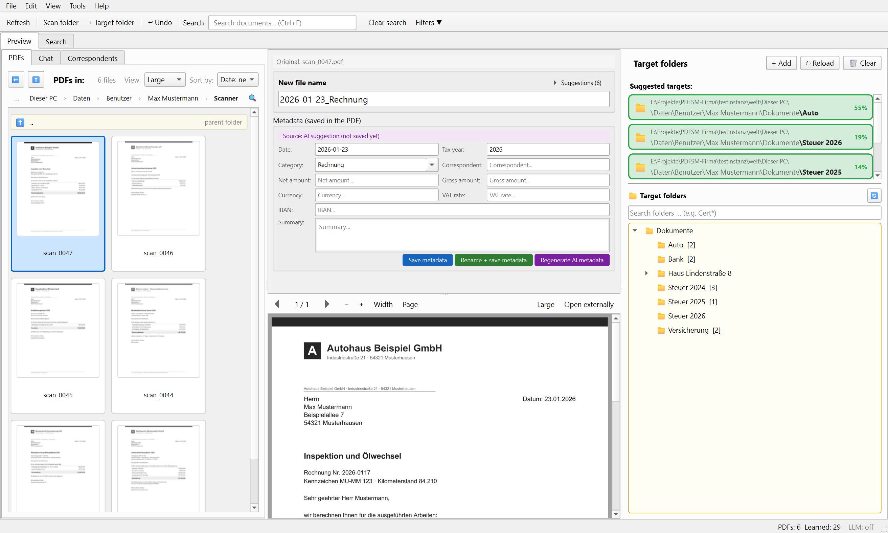

# PDF Sortier Meister

*Deutsch: [README.md](README.md)*

**Sort, rename and find scanned PDFs — on your own PC (Windows & macOS), without a server, with local AI.**

[](https://github.com/Josi-create/PDF_Sortier_Meister/releases/latest)


[](LICENSE)



Your scanner saves `scan_0042.pdf` — and then? PDF Sortier Meister shows the scans as previews,
suggests a target folder and a meaningful file name, writes category, amount and tax year as
metadata **into the PDF itself**, and learns from every decision. Your files stay ordinary PDFs in
ordinary folders (OneDrive works too) — no database silo, no Docker, no server. It also includes a
**full-text search across the whole PC**: PDFs including scans, Word and Excel files, Markdown and
mails — also available to AI assistants such as Claude.

> 🧪 **Beta.** The program works and is used daily, but so far by few people. Feedback is welcome.

## Language

The program is available in German and English. If Windows or macOS is set to German, it starts
in German; with any other system language it starts in English. You can change this under
*Settings → General → Language* (takes effect after a restart).

Still German in the English version for now: file names, categories and summaries suggested by
the AI, the file name placeholders and templates, and the quick questions in the chat. The search
keywords (`ODER`, `NICHT`, `ab`, `bis`) are the same in both languages.

## Installation

### Windows

1. Download [`PDF_Sortier_Meister_Setup.exe`](https://github.com/Josi-create/PDF_Sortier_Meister/releases/latest/download/PDF_Sortier_Meister_Setup.exe) — this link always points to the latest version.
2. Double-click the setup file → Next → Finish.
3. At the first start, the setup wizard guides you through scan folder, target folder and (optionally) an AI provider.

Text recognition (OCR, Tesseract) is **included**. To update, install the new version over the old
one; settings and learned data are kept. Windows SmartScreen may warn because the program is not
signed: *“More info” → “Run anyway”*. A portable ZIP is on the
[release page](https://github.com/Josi-create/PDF_Sortier_Meister/releases/latest).

### macOS

1. Download the DMG for your chip:
   [Apple Silicon](https://github.com/Josi-create/PDF_Sortier_Meister/releases/latest/download/PDF_Sortier_Meister-macos-arm64.dmg) ·
   [Intel](https://github.com/Josi-create/PDF_Sortier_Meister/releases/latest/download/PDF_Sortier_Meister-macos-x86_64.dmg)
2. Open the DMG and drag “PDF Sortier Meister” onto “Applications”.

## What it does

### Sorting like in a file manager, but with suggestions
- **Scan folder as a file manager**: folder rows, breadcrumb, `Alt+↑`, tile sizes small / medium / large
- **Target folder suggestions** from the PDF content, learning locally and offline
- **One click** on a target folder moves the file, renames it and saves the metadata in one go
- Drag & drop, multiple selection, **undo** (`Ctrl+Z`), copying into several folders
- Explorer context menu: right-click a folder or PDF → open it in PDF Sortier Meister

### Renaming
- Suggestions from the detected **date**, **category**, **sender** and your own earlier renames
- Your own **file name pattern** with placeholders (`{datum}_{kontakt}_{betreff}`) and live preview
- **Split PDFs**, **AI-assisted splitting** of scanned batches, **stacking** PDFs like sheets of paper
- Convert Word, Excel, OpenDocument files and photos to PDF; correct the perspective of phone photos

### Metadata in the PDF, not in a database
- Category, correspondent, amount (net/gross), VAT, IBAN, tax year and summary are written as
  **XMP metadata into the PDF** — an ISO standard that survives copying and moving
- **Tax report**: yearly totals by category with **CSV export**

### AI — optional, local or cloud
- Without AI everything above works with the local classifier
- With AI: better folder and name suggestions, automatic metadata extraction and a
  **chat about your own documents** with clickable sources
- Providers: **Ollama** (local, no API key), Ollama Cloud, LM Studio, OpenRouter, Anthropic Claude, OpenAI, Poe
- The setup wizard checks your graphics card and recommends a suitable local model

### Document search across the whole PC
- **Full-text search** in PDFs (including scans), Word, Excel, OpenDocument, Markdown and mails
  (Thunderbird, `.eml`, `.msg`) in the folders and drives you choose; off by default
- Runs **once a day in the background** when the computer is idle
- Optional invisible **text layer** for new scans, rotation and straightening — always with a backup copy
- **AI assistants (MCP)**: Claude Code, Claude Desktop and other MCP-capable programs can search the
  index through `pdfsm-dienst`; all tools are read-only. Set it up under
  *Settings → Search → AI assistants (MCP)*

## Privacy

This is a desktop program. Without a configured cloud provider, **nothing** leaves your computer.

| Setting | What leaves the computer |
|---|---|
| No AI provider (default) | nothing |
| **Ollama**, LM Studio (local) | nothing — the model runs on your PC |
| Cloud provider | a **text excerpt** of the PDF (500–5000 characters, default 1500) — only after explicit consent in the settings; the PDF file itself is never uploaded |
| Document search, browser interface | nothing — index and interface stay on the computer (`localhost`) |
| AI assistant via MCP | whatever the assistant requests through the tools goes to its provider |

All data (configuration, learning history, search index, logs) is stored in
`%APPDATA%\PDF_Sortier_Meister\` (macOS: `~/Library/Application Support/PDF_Sortier_Meister`).
There is no telemetry.

## Feedback and support

- 🐛 [Report a bug](https://github.com/Josi-create/PDF_Sortier_Meister/issues/new?template=bug_report.yml)
- 💡 [Suggest an idea](https://github.com/Josi-create/PDF_Sortier_Meister/issues/new?template=feature_request.yml)
- ☕ [buymeacoffee.com/josicreate](https://buymeacoffee.com/josicreate) — voluntary, unlocks nothing

## Running from source

```bash
git clone https://github.com/Josi-create/PDF_Sortier_Meister.git
cd PDF_Sortier_Meister
python -m venv venv
venv\Scripts\activate
pip install -r requirements.txt
python run.py
```

Python 3.10+, Windows 10/11 or macOS. Tests: `python -m pytest tests -q`. To try the English
interface on a German system, set the environment variable `PDFSM_LANGUAGE=en`. Translations live
in `src/i18n/locale/*.po`; see [src/i18n/README.md](src/i18n/README.md) (German) for how to add
texts or another language. Architecture: [docs/ARCHITECTURE.md](docs/ARCHITECTURE.md) (German).

## License

**GPL-3.0-or-later** — see [LICENSE](LICENSE). Two core libraries are copyleft (PyQt6: GPLv3,
PyMuPDF: AGPLv3), so the program passes on the same freedom.
